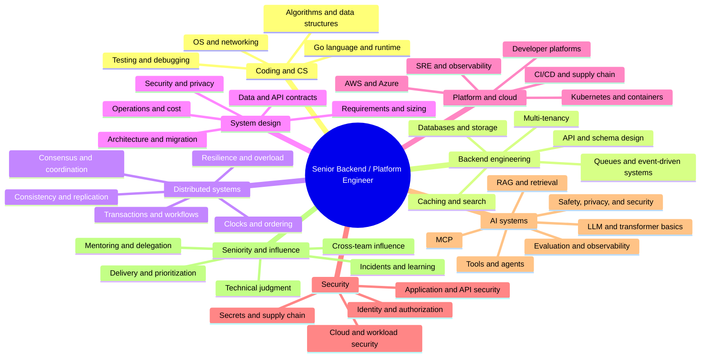

# Interview Knowledge Graph and Topic Roadmap

This is a working syllabus for senior backend/platform interviews, not a claim that every employer asks every topic. Priorities are role-fit judgments for the profile in the request. “Frequency” is qualitative: **Core** means broad, role-independent baseline; **Common** means frequently relevant to matching senior roles; **Selective** means team-specific or Staff-level depth; **Emerging** means fast-changing and not yet a universal screen.

## How to Use This Roadmap

- First pass: rebuild first principles and produce a one-page explanation per topic.
- Second pass: implement or diagnose the concept, then explain its tradeoffs out loud.
- Interview pass: solve an unseen problem or design under time, state assumptions, test failure modes, and receive feedback.
- Reclassify any topic against a real job description. A role posting and recruiter screen outrank this generic weighting.
- Hours below are approximate active study for a working professional, not guarantees. The full breadth is much larger than the available 30/60/90-day time budgets; the execution plan selects the Pareto path.

## Knowledge Graph

## Priority Ladder

| Priority | Meaning | Study behavior |
| --- | --- | --- |
| P0 | Broad interview gate and directly aligned to stated roles | Explain, implement/design, test, and practice under time |
| P1 | Strong differentiator for senior backend/platform roles | Explain tradeoffs and failure behavior; build one practical exercise |
| P2 | Staff, specialist, or team-dependent depth | Learn boundaries, failure modes, and when the tool is justified |
| P3 | Emerging or niche; only deepen for target job evidence | Maintain an interview-ready vocabulary and revisit from postings |

## Topic Catalog

| Topic / child nodes | Priority / frequency | First principles to master | Common trap / interview evaluation | Study time |
| --- | --- | --- | --- | --- |
| Problem solving: arrays, strings, hash maps, sets, stacks, queues, linked lists, trees, heaps, graphs, intervals, tries, sorting, binary search, recursion, dynamic programming, greedy, union-find, topological order, complexity | P0 / Core | Translate constraints to an invariant; select structure; derive time/space; test boundaries | Coding immediately without examples; interviewer evaluates correctness, communication, tests, complexity | 35-55h |
| Go basics: types, declarations, functions, methods, pointers, structs, interfaces, generics, packages, modules, errors, defer/panic/recover, slices/maps, reflection | P0 / Common | Value semantics, method sets, interface satisfaction, slice backing arrays, map safety, error wrapping | Claiming an interface value is simply a pointer; confusing nil interface with typed nil; copy/alias bugs | 20-30h |
| Go concurrency: goroutines, channels, select, context, WaitGroup, Mutex/RWMutex, atomics, condition variables, cancellation, backpressure, worker pools | P0 / Common | Happens-before, ownership, lifecycle, bounded work, cancellation propagation, channel close ownership | “Channels are always better than locks”; leaked goroutine; unbounded goroutine-per-item; closing from receiver | 20-30h |
| Go runtime/performance: scheduler, GC, allocation, escape analysis, stack growth, compiler/inlining, pprof, trace, race detector, benchmarks, PGO | P1 / Common-to-selective | Use measurements; identify CPU vs allocation vs lock/block; read escape output and profiles | Trivia-first optimization; assume GOMAXPROCS equals goroutine count; ignore profiler overhead | 12-20h |
| Tests and code quality: unit/integration/contract/e2e, table tests, fuzz, race tests, mocks, deterministic clocks, benchmarks, test pyramid | P0 / Core | State behavior and invariants; isolate external systems without losing contract confidence | Coverage percentage as proof; brittle mock-heavy tests; no failure-path tests | 10-16h |
| API/service design: REST, GraphQL, gRPC, versioning, pagination, idempotency, validation, timeouts, retries, compatibility, rate limits | P0 / Common | Contract boundaries, client/server ownership, schema evolution, error semantics | Retry all errors; expose storage schema; omit deadlines and compatibility | 10-18h |
| Relational data: SQL, joins, constraints, indexes, transactions, isolation, MVCC, locks, deadlocks, query plans, WAL, vacuum, partitioning, replication | P0 / Common | Data invariants, query plans, write/read patterns, isolation anomaly, lock scope | Index every column; confuse isolation labels; ignore write amplification, bloat, connection pools | 20-30h |
| Redis and cache: data structures, TTL, eviction, cache-aside/write-through, invalidation, replication, Sentinel/Cluster, hot keys, consistency | P1 / Common | Cache is derived state; describe stale-read and cold-cache behavior; design invalidation | Treat Redis as durable database; assume asynchronous replication means zero data loss | 8-14h |
| Document/search/vector stores: MongoDB data modeling, secondary indexes, sharding, search indexing, vector embeddings, ANN tradeoffs | P1/P2 / Common/selective | Query-shaped schema, consistency, index build and shard key; vector recall/latency/cost | “NoSQL scales better”; use a vector DB without retrieval evaluation or filtering strategy | 8-16h |
| Messaging/Kafka: partitions, ordering, replication, ISR, leader/follower, producer acks, idempotence, transactions, consumer groups, offsets, rebalances, KRaft, retention, compaction, Connect, Streams | P0 / Common | Per-partition ordering; offset commit boundary; duplicate delivery; lag and rebalance | Claim global ordering or unconditional exactly-once; ignore side effects outside Kafka transaction | 20-30h |
| Distributed systems: partial failure, failure detectors, CAP, consistency models, quorum, replication, consensus, Raft/Paxos, clocks, leases, locks, CRDTs | P0/P1 / Common | State assumptions, topology, safety vs liveness, partitions, retries and recovery | Treat CAP as “pick two”; use wall clocks for ordering; call a lease a perfect lock | 20-30h |
| Workflow consistency: outbox, CDC, idempotency, deduplication, saga, compensation, event sourcing, CQRS, transactional boundary | P0 / Common | Identify atomicity boundary; persist intent and delivery; model replay and duplicate effects | “Exactly once” across DB+broker; compensation assumed to reverse reality | 12-20h |
| System design: requirements, capacity, API/data model, partitioning, caches, queues, SLO, consistency, migration, security, cost | P0 / Core | Clarify use cases and constraints; derive estimates; choose simple architecture; analyze bottlenecks/failures | Draw boxes before requirements; no estimates; no operational or migration plan | 25-40h |
| Cloud: AWS/Azure identity, network, compute, storage, managed data, queues, load balancing, autoscaling, regions, resilience, cost | P1 / Common | Public/private networking, IAM least privilege, failure domains, managed-service limits | Treat cloud service names as design; ignore quotas, egress, and shared responsibility | 12-20h |
| Kubernetes: API objects, control plane, scheduler, workloads, probes, services, ingress, DNS, config/secrets, storage, RBAC, network policy, HPA, rollout, disruption | P1 / Common for platform | Desired-state reconciliation, readiness vs liveness, resource requests/limits, pod lifecycle | “Kubernetes restarts it” as full HA; forget app-level state and dependency behavior | 12-20h |
| Platform engineering: internal developer platform, paved roads, self-service, golden paths, policy, portal, templates, platform SLO, adoption, cognitive load | P1 / Common for platform | Internal user needs, product ownership, opt-in/guardrail balance, adoption measurement | Build a portal without improving delivery; central team becomes ticket queue | 8-14h |
| SRE/observability: SLIs/SLOs/error budgets, alerts, logs/metrics/traces, OpenTelemetry, incident response, postmortems, capacity, overload | P0/P1 / Common | User-visible indicators, cardinality, sampling, context propagation, alert actionability | Dashboard vanity metrics; alert on symptoms without action; no runbook or recovery | 12-18h |
| Security: OAuth2/OIDC, JWT, sessions, mTLS, RBAC/ABAC, tenant isolation, SSRF, injection, CSRF, secrets, supply chain, threat modeling | P0/P1 / Common | Authn vs authz, trust boundaries, token validation, least privilege, tenant isolation | JWT treated as encrypted; validate signature but not issuer/audience/expiry; secret in logs | 12-20h |
| AI/LLM systems: tokens, transformer intuition, embeddings, retrieval, RAG, reranking, tool calling, agent state, MCP, evals, safety, guardrails, observability | P2/P3 / Emerging and role-dependent | Model non-determinism, retrieval quality, latency/cost, fallback, evaluation, access control | Prompt-only “security”; demo without evaluation; unrestricted tools; treat MCP as authorization | 12-24h foundational; more for AI roles |
| Leadership/behavioral: ownership, conflict, failures, ambiguity, prioritization, influence, mentoring, incident leadership, business outcomes | P0 / Core | Specific personal contribution, stakes, options, decision, outcome, learning | “We” obscures role; no measurable outcome; false perfection; blames others | 12-18h plus practice |

## Go Master Roadmap

### Beginner: regain fluency

- Syntax and types: zero values, constants, named types, structs, methods, interfaces, generics, package/module boundaries.
- Pointers and values: assignment copies values; slices contain a pointer/length/capacity descriptor referencing an array; maps and channels are reference-like runtime values; aliases can observe shared mutation.
- Interfaces: a value carries dynamic type and dynamic value; a nil interface differs from an interface containing a typed nil pointer. Implicit implementation keeps dependencies decoupled.
- Errors: wrap with `%w`, inspect with `errors.Is/As`, define sentinel/type errors intentionally, return errors rather than panic for ordinary failures.
- Collections: append may allocate and copy; capacity is not a stable aliasing contract; map iteration order is unspecified and concurrent map mutation is unsafe.
- Exercises: implement an LRU cache, bounded queue, retry helper with injected clock, HTTP handler with request validation.

### Intermediate: concurrency and production patterns

- Goroutine creation is cheap relative to OS threads, not free; every goroutine needs a termination condition and an owner.
- Channel send/receive and close establish synchronization edges under the Go memory model. Mutexes and atomics also establish synchronization; choose the clearest ownership model.
- `select` can make operations cancellable. `context.Context` carries cancellation/deadline/request-scoped values; do not store it in long-lived structs or use it as an optional parameter bag.
- Bound concurrency, queue size, retries, and fan-out. Propagate deadlines; add jitter and retry budgets; distinguish cancellation from timeout and permanent errors.
- Select one goroutine as channel closer; never close a channel just to signal a single receiver when context cancellation is clearer.
- Exercises: cancellable fan-out/fan-in pipeline; worker pool with bounded queue and graceful shutdown; race a shared counter and fix with mutex/atomic; write tests using `go test -race`.

### Advanced: memory, performance, and diagnosis

- Memory model: data-race-free Go programs have sequentially consistent behavior; a race is not merely stale data. Read the official synchronization guarantees for channels, locks, `Once`, and atomics.
- Escape analysis: compiler decides whether an allocation may outlive a stack frame; inspect with `go test -gcflags=-m`; do not assume every pointer escapes or optimize based on source intuition.
- GC: understand allocation rate, live heap, pacing, roots, and latency/throughput tradeoffs; diagnose before tuning `GOGC` or memory limits.
- Profiling: CPU pprof for hot CPU paths; heap/alloc profiles for allocation; block/mutex profiles for contention; execution trace for scheduling/syscall/GC timing; race detector for races. Profiles can perturb runtime behavior.
- Benchmarking: compare equivalent workloads, use `benchstat`, avoid dead-code elimination and shared mutable state; check allocation with `-benchmem`.
- Exercises: reduce allocations in a JSON pipeline based on profiles; diagnose a goroutine leak from stacks; compare lock contention using profiles; build and interpret a trace.

### Expert: explain a design decision, not trivia

Be ready to discuss scheduler behavior at a practical level (G/M/P model and work stealing), preemption, syscall/cgo effects, stack growth, compiler optimization and inlining, GC cost, and performance tradeoffs. For Staff roles, explain how runtime behavior constrains service-level capacity and incident response. Avoid asserting exact implementation details without naming Go version; runtime internals evolve.

**Go question set:** Why can a typed nil produce a non-nil interface? How can `append` corrupt assumptions across slices? What happens to goroutines blocked on send after a consumer exits? What ordering does a channel operation guarantee? When is a mutex clearer than a channel? How do you prove cancellation exits every goroutine? How would you distinguish CPU saturation from lock contention and GC pressure? What does escape analysis tell you, and what does it not tell you?

**Expected answer shape:** state semantics, show minimal example, name the failure, give safe pattern, show how to test/measure. Reference: [Go specification](https://go.dev/ref/spec), [Go memory model](https://go.dev/ref/mem), [Go diagnostics](https://go.dev/doc/diagnostics), [Go pipelines/cancellation](https://go.dev/blog/pipelines).

## Distributed Systems and Failure Scenarios

| Concept cluster | Need to explain | Scenario to rehearse | Common mistake |
| --- | --- | --- | --- |
| CAP and consistency | CAP applies during a network partition; consistency and availability are scoped guarantees, not toggles; define linearizable, sequential, causal, eventual reads | Region link splits while writes continue; decide accepted behavior and recovery | “Choose two” with no workload/failure context |
| Replication and quorums | Leader/follower, sync/async ack, quorum intersection, stale reads, lag, failover and split brain | Leader fails after ack but before replica catches up | Claim zero loss without quorum/commit guarantees |
| Consensus/leader election | Raft terms, log matching, majority commit, leader election, safety/liveness; Paxos at conceptual level; fencing | Old leader resumes after partition; prevent stale writer | Treat timeout as proof of failure |
| Clocks and ordering | Physical clock drift, monotonic time, Lamport/vector clocks, sequence numbers, event time | Out-of-order events across regions | Use timestamps as globally unique order |
| Distributed locks/leases | Lease expiry, clock assumptions, fencing tokens, ownership epochs; prefer DB uniqueness/conditional writes when adequate | Paused holder resumes after lease expired | Assume lock service alone prevents stale effects |
| Idempotency/delivery | At-most-once/at-least-once delivery; idempotent effects; dedupe keys and retention; retry safety | API times out after side effect committed | Call an HTTP retry exactly-once |
| Outbox/CDC | Commit business state and outbox row atomically; relay or CDC publishes; consumer idempotency; schema evolution | Broker unavailable during transaction | Dual-write DB and broker directly |
| Saga/workflow | Local transactions, durable state machine, retry, timeout, compensation, manual resolution | Payment captured; inventory reservation fails | Assume compensation erases external irreversible action |
| Event sourcing/CQRS | Event log as source of truth, projection lag, rebuild, versioning, snapshots, query model | New projection needs backfill under live writes | Adopt for every CRUD app |
| CRDTs | Merge properties, convergence assumptions, tombstones, conflict semantics, user-visible consistency | Offline edits converge after reconnect | Use CRDT without business conflict semantics |
| Fault tolerance | Bulkheads, circuit breakers, deadlines, bounded retries, load shedding, hedging, backpressure, graceful degradation | Dependency latency rises and retry storm amplifies load | Retry without budget or deadline |

## Database Master Class

### PostgreSQL

Study data modeling, constraints, normalization/denormalization, B-tree/GIN/GiST/BRIN selection, composite and partial indexes, `EXPLAIN (ANALYZE, BUFFERS)`, join algorithms, statistics, connection pooling, MVCC snapshots, isolation anomalies, row/table/advisory locks, deadlock detection, WAL/checkpoints, autovacuum, bloat, partition pruning, logical/physical replication, backups/PITR, and migration safety. The official manual explains that each statement sees a snapshot and describes isolation/locking/anomaly handling: [MVCC introduction](https://www.postgresql.org/docs/current/mvcc-intro.html), [concurrency control](https://www.postgresql.org/docs/current/mvcc.html).

Interview drill: explain a sequential scan despite an index; diagnose lock contention; design a zero-downtime column migration; choose isolation level for inventory reservation; recover a replica lag incident; tune a query with actual plan evidence.

### Redis

Study strings, hashes, sets, sorted sets, streams, TTL, eviction, persistence (RDB/AOF), replication offsets and partial resync, Sentinel vs Cluster, hot keys, pipelining, Lua/Functions, cache stampede, invalidation, and data-loss boundaries. Redis replication is asynchronous by default; `WAIT` narrows but does not eliminate every failover-loss scenario. See [Redis replication](https://redis.io/docs/latest/operate/oss_and_stack/management/replication/).

Interview drill: prevent cache stampede; choose TTL/invalidation; handle stale replica reads; size hot-key mitigation; decide when not to cache; distinguish cache from durable queue/database.

### MongoDB and search/vector stores

Understand document boundaries, embedding data with access-control metadata, indexes, shard keys, replica sets, read/write concerns, aggregation pipelines, schema evolution, change streams, and backups. For vector retrieval: embedding model/version, chunking, approximate nearest neighbor recall/latency, metadata filtering, hybrid keyword/vector search, reranking, and evaluation. Interview answer must include tenant filters and authorization in retrieval, not only similarity score.

## Kafka Master Class

- **Log model:** topic partitions are append-only ordered logs; ordering exists within a partition, not across the whole topic. Key choice drives partition affinity and hot partition risk.
- **Replication:** leader and followers; ISR tracks replicas caught up sufficiently under configured conditions. `acks`, `min.insync.replicas`, unclean leader election, and producer retries jointly affect durability/availability.
- **Producer:** idempotent producer prevents duplicate writes due to supported retries within Kafka's protocol; transactions can atomically write across partitions and commit consumed offsets, but do not atomically commit an external database side effect.
- **Consumer groups:** one active consumer per partition per group; adding consumers beyond partitions does not increase parallelism. Offset commit timing determines replay/loss risk. Rebalances pause or redistribute work; cooperative/sticky strategies reduce disruption but do not remove coordination cost.
- **Exactly once:** describe the exact boundary and API. For Kafka consume-transform-produce, transactions can provide exactly-once processing semantics within Kafka; external sinks require idempotency or coordinated transaction support.
- **Operations:** KRaft metadata quorum, broker/controller roles, replication factor, partition count, disk/network, retention vs compaction, quotas, lag, under-replicated partitions, controller failover, rolling upgrades, schema registry/contracts, Connect and Streams.
- **Failure drill:** consumer performs DB write, crashes before offset commit: duplicate processing. Fix with idempotent DB effect, inbox/dedup key, or outbox pattern as appropriate.
- **Interview questions:** How does a partition leader recover? What happens when ISR shrinks below minimum? How do you preserve ordering while scaling? How do you handle poison messages? How do you select keys? Why can rebalancing cause latency spikes? How would you drain a consumer safely?

Primary source: [Apache Kafka documentation](https://kafka.apache.org/documentation/). Review the release/version in a target role; broker behavior evolves.

## System Design Set

Use one consistent interview loop: clarify users and invariants; quantify traffic/storage/latency; define APIs and data model; sketch a simple design; discuss partitioning, caching, replication, consistency, security, SLOs, failure recovery, migration, and cost. State what is unknown and how you would validate it.

| Design exercise | Core requirements and design tensions to cover |
| --- | --- |
| URL shortener | Read/write ratio, collision strategy, redirects, cache, abuse prevention, analytics, keyspace growth |
| YouTube/video platform | Upload pipeline, transcoding, object storage/CDN, metadata, playback quality, rights and moderation |
| Instagram/social feed | Fanout-on-write/read, ranking, celebrity hot keys, media storage, pagination, privacy |
| Netflix streaming | Catalog, entitlement, CDN, adaptive bitrate, regional failover, telemetry |
| WhatsApp/chat | Ordering, delivery receipts, offline queues, end-to-end encryption, multi-device, fanout |
| Google Drive/file sync | Chunking, version history, conflict resolution, sync cursors, sharing, malware scanning |
| Google Maps/geo search | Geospatial indexing, traffic updates, tile/cache strategy, freshness, regional data |
| Uber/ride dispatch | Location streams, matching, state machine, idempotent payment, surge, partitioning and safety |
| Stripe/payment gateway | Idempotency, ledger, authorization/capture/refund, reconciliation, auditability, PCI boundaries |
| Notification service | Preferences, dedupe, fanout, provider retries, rate limits, delivery status and quiet hours |
| Search engine | Ingest/index pipeline, inverted index, freshness, ranking, shards, query latency, access control |
| API gateway | Authn/authz, routing, quotas, retries, timeouts, tenant fairness, config propagation |
| Rate limiter | Token/leaky bucket, local vs distributed state, burst behavior, fail-open/closed, hot keys |
| Cloud security platform | Asset ingestion, identity graph, policy evaluation, finding dedupe, tenant isolation, event latency |
| EV charging platform | Station/EVSE/connector model, live status, roaming, session lifecycle, billing, idempotency, offline station, geography |
| Kafka-like platform | Partition assignment, replication, metadata, consumer groups, durability, tenant quotas, control plane |
| Multi-tenant SaaS | Tenant isolation, noisy-neighbor control, data residency, provisioning, per-tenant limits, billing and deletion |
| Feature flag system | Evaluation latency, SDK cache, targeting rules, safe rollout, audit, config consistency, kill switch |
| LLM platform | Model routing, token budgets, queues, tenant isolation, caching, evals, provider fallback, abuse and cost controls |
| Agent platform | Tool registry, scoped credentials, sandboxing, durable workflow, approvals, cancellation, trace/evaluation |
| Internal developer platform | Golden paths, templates, policy guardrails, deployment, self-service, adoption metrics, platform SLO |

For every design, expect follow-ups on capacity math, failure recovery, data deletion, authorization, observability, deployment/migration, and cost. A strong design is not the largest design; it is the smallest design that meets stated requirements and has a credible evolution path.

## AI for Software Engineers

| Topic | Explain / design / practice | Risk or trap |
| --- | --- | --- |
| LLM/transformer fundamentals | Tokens, embeddings, attention intuition, context window, sampling, latency, throughput, model limits | Do not claim a model “knows” ground truth or can guarantee determinism |
| Embeddings and retrieval | Chunking, metadata filters, hybrid retrieval, reranking, recall/precision and relevance evaluation | Similarity is not authorization or factuality |
| RAG | Ingest/version pipeline, query rewrite, retrieve, rerank, cite, abstain, freshness, cache | Measure retrieval and answer quality separately |
| Tool calling and agents | Explicit state machine, tool schema, bounded steps, timeout/cancel, approval, durable execution, idempotent effects | An agent loop is not inherently reliable; model output is untrusted input |
| MCP | Host/client/server, JSON-RPC, resources/prompts/tools, negotiation, consent and authorization | MCP is an integration protocol, not an authorization system; tool metadata may be untrusted |
| Evaluation | Curated representative sets, correctness/relevance, groundedness, safety, latency, cost, regression and human review | A few happy-path demos are not an evaluation strategy |
| Security and privacy | Prompt injection, data exfiltration, excessive agency, insecure output handling, supply chain, tenant boundaries | Prompt filters alone do not secure tool permissions or data access |
| Observability | Trace model/tool/retrieval steps, token/cost/latency, versions, quality feedback, redaction | Do not log secrets, full prompts, or personal data by default |
| Fine-tuning | Use-case decision vs prompting/RAG, data quality, versioning, evaluation, drift, serving cost | Fine-tuning is not the default solution for missing knowledge |
| Multi-agent systems | Coordination cost, shared state, supervisor vs handoff, failure propagation, budget | Add agents only where decomposition measurably helps |

MCP reference: [specification](https://modelcontextprotocol.io/specification/2025-06-18). AI security reference: [OWASP GenAI Top 10](https://genai.owasp.org/llm-top-10/). These sources define technical concepts and risks; they do not prove every interview loop tests them.

## Cloud, Kubernetes, Platform, Security, and Observability

- **AWS/Azure:** IAM roles and policies, VPC/VNet, DNS, load balancers, private endpoints, compute choices, object/block/file storage, managed DB, queues, key management, logs/metrics, quotas, multi-zone/region design, backup/PITR, cost and egress. Compare services by guarantees and operational burden rather than name matching. Use [AWS Well-Architected Framework](https://docs.aws.amazon.com/wellarchitected/latest/framework/welcome.html) and the equivalent Azure architecture/security/reliability centers for target-specific study.
- **Kubernetes:** control plane and reconciliation; Deployment/StatefulSet/DaemonSet/Job; Service/Ingress/Gateway; readiness/liveness/startup probes; requests/limits; HPA; PDB; affinity/taints; secrets/RBAC/network policy; PVC/CSI; rollout/rollback; DNS and service discovery; autoscaling limits. Kubernetes is a building block, not a complete PaaS or application-level database/queue; see [official overview](https://kubernetes.io/docs/concepts/overview/).
- **Platform engineering:** identify developer journey friction; make the platform discoverable, self-service and safe; build paved roads with escape hatches; measure adoption and lead time rather than portal page views; own platform SLOs and migration communications.
- **Observability:** use RED for request services and USE for resource saturation as heuristics, not laws; define user-centered SLIs; control label cardinality; propagate trace context; sample deliberately; redact secrets/PII; connect alerts to actions and runbooks. OpenTelemetry is vendor-neutral instrumentation/collection/export for traces, metrics, and logs: [OTel docs](https://opentelemetry.io/docs/).
- **Security:** OAuth2 authorization flows, OIDC identity, JWT signing/claims/audience/expiry/key rotation, mTLS, service identity, RBAC vs ABAC, CSRF, SSRF, SQL/command injection, request smuggling, secret rotation, KMS, SBOM/provenance/signing, dependency and container scanning, least privilege, audit and tenant isolation.

## Interview Evaluation Rubric

| Skill | Strong evidence | Weak evidence |
| --- | --- | --- |
| Problem solving | Clarifies, decomposes, states invariant, tests edge cases, adjusts to hints | Guesses a memorized pattern and cannot explain correctness |
| Technical depth | Explains implementation boundary and failure modes with precise guarantees | Uses slogans (“eventual,” “exactly once,” “highly available”) without scope |
| Judgment | Compares viable options, chooses proportionately, states reversibility and evidence needed | Adds technologies without a requirement or rejects tradeoffs categorically |
| Senior ownership | Defines personal contribution, coordinates dependencies, measures outcome, follows through | Vague team narrative, no result or unresolved operational ownership |
| Staff influence | Changes direction across teams, creates alignment and leverage, sustains adoption | Treats Staff as “architect only” or relies on title/authority |
| Production readiness | Includes SLO, rollout, observability, incident/recovery, security, cost | Architecture stops at happy-path request flow |

## Free Resource Index

Resources below are selected for direct learning from primary or well-established free material. Video availability and course hosting can change; verify access when starting.

| Area | Documentation / course | GitHub or practice |
| --- | --- | --- |
| Algorithms | [USACO Guide](https://usaco.guide/); [CP-Algorithms](https://cp-algorithms.com/) | [LeetCode](https://leetcode.com/problemset/); [NeetCode roadmap](https://neetcode.io/roadmap) |
| Go | [A Tour of Go](https://go.dev/tour/); [Effective Go](https://go.dev/doc/effective_go); [Go diagnostics](https://go.dev/doc/diagnostics) | [Go by Example](https://gobyexample.com/); [Go exercises](https://github.com/gophercises/gophercises) |
| Distributed systems | [MIT 6.5840 public course materials](https://pdos.csail.mit.edu/6.824/); [Designing Data-Intensive Applications reading group notes](https://github.com/ept/ddia-references) | [Jepsen analyses](https://jepsen.io/analyses); [Raft visualization](https://raft.github.io/) |
| System design | [System Design Primer](https://github.com/donnemartin/system-design-primer) | [Hello Interview system design](https://www.hellointerview.com/learn/system-design/in-a-hurry/introduction) (free material varies) |
| PostgreSQL | [PostgreSQL manual](https://www.postgresql.org/docs/current/); [Use The Index, Luke](https://use-the-index-luke.com/) | [Postgres exercises](https://pgexercises.com/) |
| Redis | [Redis docs](https://redis.io/docs/latest/) | [Redis University](https://university.redis.com/) free self-paced courses |
| Kafka | [Apache Kafka docs](https://kafka.apache.org/documentation/); [Kafka tutorials](https://developer.confluent.io/) | [Kafka examples](https://github.com/confluentinc/examples) |
| Kubernetes | [Kubernetes docs](https://kubernetes.io/docs/); [Kubernetes the hard way](https://github.com/kelseyhightower/kubernetes-the-hard-way) | [KillerCoda Kubernetes scenarios](https://killercoda.com/kubernetes) |
| Cloud | [AWS Well-Architected Labs](https://wellarchitectedlabs.com/); [AWS Skill Builder free training](https://skillbuilder.aws/) | [Azure Architecture Center](https://learn.microsoft.com/azure/architecture/) |
| Security | [OWASP Web Security Testing Guide](https://owasp.org/www-project-web-security-testing-guide/); [OWASP Cheat Sheet Series](https://cheatsheetseries.owasp.org/) | [OWASP Juice Shop](https://github.com/juice-shop/juice-shop); [PortSwigger Web Security Academy](https://portswigger.net/web-security) |
| AI systems | [Hugging Face NLP course](https://huggingface.co/learn/nlp-course/); [Full Stack Deep Learning](https://fullstackdeeplearning.com/) | [OWASP GenAI project](https://github.com/OWASP/www-project-top-10-for-large-language-model-applications); [MCP examples](https://github.com/modelcontextprotocol) |
| SRE/observability | [Google SRE Workbook](https://sre.google/workbook/table-of-contents/); [OpenTelemetry docs](https://opentelemetry.io/docs/) | [OpenTelemetry demo](https://github.com/open-telemetry/opentelemetry-demo) |
| Behavioral | [Amazon Leadership Principles](https://www.amazon.jobs/content/en/our-workplace/leadership-principles); [Microsoft values and hiring](https://careers.microsoft.com/v2/global/en/hiring-tips.html) | Use the bank in `behavioral-question-bank.md`; record and review mock answers |
